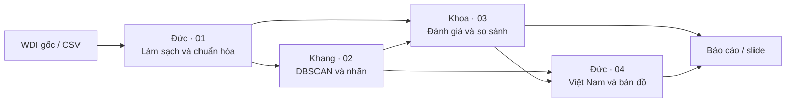

<div align="center">

# DBSCAN · Economics

### Phân cụm quốc gia theo đặc điểm kinh tế vĩ mô<br>và khám phá các nền kinh tế khác biệt


**8 chỉ tiêu** · **2010–2024** · **217 nền kinh tế** · **4 notebook** · **3 thành viên**

[Bắt đầu](#bắt-đầu-trong-vài-phút) · [Dataset CSV](du_lieu/du_lieu_tho/wdi_2010_2024.csv) · [Phân công](#phân-công-và-thứ-tự-làm-việc) · [Tài liệu dữ liệu](du_lieu/README.md) · [Kiểm tra khởi tạo](bao_cao/KIEM_TRA_KHOI_TAO.md)

</div>

---

## Ý tưởng nghiên cứu

Các nền kinh tế có thể tương đồng về mức sống, tăng trưởng, lạm phát, thị trường lao động và mức độ hội nhập dù ở những khu vực địa lý khác nhau. Đồ án sử dụng **DBSCAN** để tìm các nhóm quan sát có mật độ cao trong không gian đặc trưng kinh tế và nhận diện các quan sát khác biệt.

Nhóm sẽ khảo sát ba câu hỏi:

- Những quốc gia/vùng lãnh thổ nào có hồ sơ kinh tế vĩ mô gần nhau?
- Những quan sát nào được DBSCAN xem là nhiễu, và đặc điểm nào giải thích sự khác biệt đó?
- Việt Nam nằm ở đâu trong bức tranh này và tương đồng với những nền kinh tế Đông Nam Á nào qua các năm?

**Trạng thái hiện tại:** repo đã có cấu trúc nhóm, dữ liệu WDI tải sẵn và 4 notebook **chỉ chứa Markdown**. Chưa viết code Python, triển khai thuật toán, xử lý thiếu, chuẩn hóa hoặc tạo kết quả phân cụm. Chuyển dữ liệu API sang CSV chỉ thay đổi định dạng và bổ sung thông tin định danh từ metadata; mọi giá trị và ô thiếu được giữ lại.

## Dataset sẵn sàng để làm việc

| Thuộc tính | Snapshot được lưu trong repo |
| --- | --- |
| Nguồn | [World Bank — World Development Indicators](https://datacatalog.worldbank.org/search/dataset/0037712/world-development-indicators), API source `2` |
| Giai đoạn thu thập | 2010–2024, tần suất năm |
| Ngày tải | 07/11/2026, múi giờ Việt Nam |
| Bản cập nhật WDI do API công bố | 08/10/2026 |
| Phạm vi dữ liệu gốc | 266 thực thể: **217 quốc gia/vùng lãnh thổ + 49 nhóm tổng hợp** |
| CSV chính | **3.990 hàng × 12 cột**, mỗi hàng là một thực thể–năm |
| CSV dài | **31.920 hàng**, mỗi hàng là một thực thể–năm–chỉ tiêu |
| Giá trị thiếu | 3.354/31.920 giá trị, giữ dưới dạng ô CSV trống |
| Việt Nam | Mã `VNM`, đủ 120/120 giá trị của 8 chỉ tiêu trong 15 năm trước tiền xử lý |
| Kiểm chứng nguồn | JSON gốc, metadata, URL tải, thời điểm tải và SHA-256 đi kèm |

**Mở [wdi_2010_2024.csv](du_lieu/du_lieu_tho/wdi_2010_2024.csv) để bắt đầu.** File này nằm sẵn trong Git, không cần tài khoản World Bank hay tải lại khi clone repo. Bản [CSV dài](du_lieu/du_lieu_tho/wdi_2010_2024_long.csv) phục vụ đối chiếu từng quan sát; [JSON nguồn](du_lieu/du_lieu_tho/nguon_api/) phục vụ truy xuất xuất xứ.

| Mã WDI / tên cột CSV | Chỉ tiêu | Đơn vị |
| --- | --- | --- |
| `NY.GDP.PCAP.KD` | GDP bình quân đầu người | USD cố định năm 2015 |
| `NY.GDP.MKTP.KD.ZG` | Tăng trưởng GDP | %/năm |
| `FP.CPI.TOTL.ZG` | Lạm phát giá tiêu dùng | %/năm |
| `SL.UEM.TOTL.ZS` | Thất nghiệp, ước tính mô hình ILO | % lực lượng lao động |
| `NE.TRD.GNFS.ZS` | Thương mại, xuất khẩu + nhập khẩu | % GDP |
| `NE.GDI.TOTL.ZS` | Tổng tích lũy vốn | % GDP |
| `SP.URB.TOTL.IN.ZS` | Dân số đô thị | % dân số |
| `NE.CON.GOVT.ZS` | Chi tiêu tiêu dùng cuối cùng của chính phủ | % GDP |

Các cột định danh gồm `country`, `country_name`, `year`, `is_aggregate`. **49 nhóm tổng hợp vẫn được giữ trong dữ liệu gốc** và phải được loại ở notebook 01 theo `is_aggregate`/metadata trước khi phân cụm quốc gia. Danh mục 217 nền kinh tế là phạm vi nguồn, chưa phải số mẫu cuối cùng sau xử lý thiếu. Xem [schema, từ điển và nguồn tải](du_lieu/README.md) để tránh nhầm mã định danh với đặc trưng mô hình.

## Bắt đầu trong vài phút

Sử dụng **Python 3.12**. Các phiên bản thư viện trực tiếp được cố định trong [requirements.txt](requirements.txt); môi trường đã được kiểm tra trên Python 3.12.9/macOS. Các dependency gián tiếp được pip giải quyết khi cài, chưa có lockfile cho toàn bộ môi trường.

### macOS / Linux

```bash
git clone https://github.com/nguyenkhang310/DBSCAN.git
cd DBSCAN
python3.12 -m venv .venv
source .venv/bin/activate
python -m pip install -r requirements.txt
python -m pip check
jupyter notebook
```

### Windows PowerShell

```powershell
git clone https://github.com/nguyenkhang310/DBSCAN.git
cd DBSCAN
py -3.12 -m venv .venv
.\.venv\Scripts\Activate.ps1
python -m pip install -r requirements.txt
python -m pip check
jupyter notebook
```

Nếu PowerShell chặn kích hoạt môi trường, có thể gọi trực tiếp `.\.venv\Scripts\python.exe -m pip install -r requirements.txt` và `.\.venv\Scripts\jupyter.exe notebook`.

Trong Jupyter, mở notebook theo thứ tự **01 → 02 → 03 → 04**. Để chỉnh sửa bằng VS Code, mở cả thư mục `DBSCAN`, cài extension **Python** và **Jupyter** của Microsoft, mở file `.ipynb` rồi chọn kernel từ `.venv`.

Các đường dẫn trong tài liệu tính từ **gốc repo**. Kernel có thể khởi động tại thư mục chứa notebook; khi triển khai, nhóm cần xác định đúng gốc dự án trước khi đọc/ghi file để tránh tạo nhầm `du_lieu/` bên trong thư mục thành viên.

## Phân công và thứ tự làm việc

| Thành viên | Phạm vi | Notebook | Bàn giao chính |
| --- | --- | --- | --- |
| **Đức** | Dữ liệu, EDA, chuẩn hóa | [01 · Tiền xử lý](Duc/notebook/01_tien_xu_ly_du_lieu.ipynb) | Dữ liệu sạch, dữ liệu chuẩn hóa, metadata tiền xử lý |
| **Khang** | DBSCAN từ đầu, chọn tham số, kiểm chứng | [02 · DBSCAN](Khang/notebook/02_dbscan.ipynb) | Nhãn, loại điểm, cấu hình, bảng thử nghiệm |
| **Khoa** | Đánh giá, đối chứng, hồ sơ cụm và nhiễu | [03 · Đánh giá và so sánh](Khoa/notebook/03_danh_gia_va_so_sanh.ipynb) | Bảng so sánh, hồ sơ cụm, phân tích nhiễu |
| **Đức** | Việt Nam, Đông Nam Á, bản đồ | [04 · Phân tích Việt Nam](Duc/notebook/04_phan_tich_viet_nam.ipynb) | Phân tích ứng dụng và biểu đồ báo cáo |

Chi tiết nhiệm vụ: [Đức](Duc/README.md) · [Khang](Khang/README.md) · [Khoa](Khoa/README.md).



## Quy ước dữ liệu và bàn giao

**`country` + `year` là khóa liên kết bắt buộc**, không ghép bảng bằng vị trí hàng hay tên quốc gia. `country` dùng mã ba ký tự World Bank, thường tương ứng ISO3; giữ đúng mã theo metadata, kể cả mã đặc biệt. Mỗi file bàn giao cuối chỉ có một hàng cho mỗi khóa.

| Sản phẩm dự kiến | Người tạo | Nơi lưu |
| --- | --- | --- |
| `wdi_clean.csv` | Đức | `du_lieu/du_lieu_sach/` |
| `wdi_scaled.csv`, `preprocessing_metadata.json` | Đức | `du_lieu/du_lieu_chuan_hoa/` |
| `dbscan_labels.csv`, `tham_so_da_chon.json`, `grid_search.csv` | Khang | `ket_qua_chung/dbscan/` |
| `so_sanh_thuat_toan.csv` | Khoa | `ket_qua_chung/danh_gia/` |
| Hồ sơ cụm / danh sách nhiễu | Khoa | `ket_qua_chung/ho_so_cum/`, `ket_qua_chung/phan_tich_nhieu/` |
| Biểu đồ cá nhân | Mỗi thành viên | `<Tên>/bieu_do/` |
| Biểu đồ dùng chung / báo cáo / slide | Cả nhóm | `ket_qua_chung/bieu_do_bao_cao/`, `bao_cao/`, `bao_cao/slide/` |

**Bảng trên mô tả sản phẩm tương lai.** Hiện các thư mục đầu ra chỉ có `.gitkeep`, chưa có dữ liệu sạch, nhãn hoặc điểm số. Schema nhãn và nguyên tắc đánh giá được mô tả trong [quy ước kết quả chung](ket_qua_chung/README.md).

### Những quyết định cần chốt khi triển khai

- **Đơn vị phân cụm:** mỗi hàng của CSV là một nền kinh tế–năm. Phân cụm từng năm hay gộp panel phải được thống nhất và ghi vào metadata; cửa sổ 2010–2024 chỉ là phạm vi thu thập.
- **Đặc trưng:** chỉ dùng các cột chỉ tiêu đã chọn, loại định danh và `is_aggregate` khỏi ma trận khoảng cách. Ghi rõ xử lý thiếu, biến đổi và chuẩn hóa.
- **Chọn tham số:** đánh giá đồng thời độ tách cụm, độ phủ, tỷ lệ nhiễu và độ ổn định. Cấu hình toàn nhiễu hoặc chỉ một cụm cần được ghi nhận rõ.
- **Đánh giá:** báo số mẫu và chính sách noise. Các chỉ số nội bộ không hợp lệ khi số nhãn ít hơn 2 hoặc bằng số mẫu; dùng `N/A` cùng lý do. So sánh trên cùng tập mẫu để tránh kết luận từ các mẫu khác nhau.
- **So sánh qua năm:** nếu fit riêng từng năm, số nhãn cụm chỉ có ý nghĩa trong lần chạy đó; cần đối chiếu hồ sơ/thành viên cụm trước khi diễn giải chuyển dịch.
- **Diễn giải:** nhãn `-1` là noise theo dữ liệu và cấu hình mô hình, chưa đủ để kết luận khủng hoảng hoặc chất lượng điều hành kinh tế.

## Cấu trúc repository

Các file `.gitkeep` giữ lại thư mục đầu ra rỗng trên Git. Thư mục môi trường `.venv/` được bỏ qua khi commit.

```text
DBSCAN/
├── bao_cao/
│   ├── slide/
│   │   └── .gitkeep
│   └── KIEM_TRA_KHOI_TAO.md
├── du_lieu/
│   ├── du_lieu_chuan_hoa/
│   │   └── .gitkeep
│   ├── du_lieu_sach/
│   │   └── .gitkeep
│   ├── du_lieu_tho/
│   │   ├── nguon_api/
│   │   │   ├── metadata/
│   │   │   │   ├── FP.CPI.TOTL.ZG.json
│   │   │   │   ├── NE.CON.GOVT.ZS.json
│   │   │   │   ├── NE.GDI.TOTL.ZS.json
│   │   │   │   ├── NE.TRD.GNFS.ZS.json
│   │   │   │   ├── NY.GDP.MKTP.KD.ZG.json
│   │   │   │   ├── NY.GDP.PCAP.KD.json
│   │   │   │   ├── SL.UEM.TOTL.ZS.json
│   │   │   │   └── SP.URB.TOTL.IN.ZS.json
│   │   │   ├── countries.json
│   │   │   ├── FP.CPI.TOTL.ZG_2010_2024.json
│   │   │   ├── NE.CON.GOVT.ZS_2010_2024.json
│   │   │   ├── NE.GDI.TOTL.ZS_2010_2024.json
│   │   │   ├── NE.TRD.GNFS.ZS_2010_2024.json
│   │   │   ├── NY.GDP.MKTP.KD.ZG_2010_2024.json
│   │   │   ├── NY.GDP.PCAP.KD_2010_2024.json
│   │   │   ├── SL.UEM.TOTL.ZS_2010_2024.json
│   │   │   └── SP.URB.TOTL.IN.ZS_2010_2024.json
│   │   ├── manifest.json
│   │   ├── SHA256SUMS
│   │   ├── wdi_2010_2024.csv
│   │   └── wdi_2010_2024_long.csv
│   ├── README.md
│   └── tu_dien_chi_tieu.csv
├── Duc/
│   ├── bieu_do/
│   │   └── .gitkeep
│   ├── notebook/
│   │   ├── 01_tien_xu_ly_du_lieu.ipynb
│   │   └── 04_phan_tich_viet_nam.ipynb
│   └── README.md
├── ket_qua_chung/
│   ├── bieu_do_bao_cao/
│   │   └── .gitkeep
│   ├── danh_gia/
│   │   └── .gitkeep
│   ├── dbscan/
│   │   └── .gitkeep
│   ├── ho_so_cum/
│   │   └── .gitkeep
│   ├── phan_tich_nhieu/
│   │   └── .gitkeep
│   └── README.md
├── Khang/
│   ├── bieu_do/
│   │   └── .gitkeep
│   ├── notebook/
│   │   └── 02_dbscan.ipynb
│   └── README.md
├── Khoa/
│   ├── bieu_do/
│   │   └── .gitkeep
│   ├── notebook/
│   │   └── 03_danh_gia_va_so_sanh.ipynb
│   └── README.md
├── .gitignore
├── README.md
└── requirements.txt
```

## Làm việc nhóm trên `main`

Cả nhóm dùng **một repo và nhánh `main`**, không tạo nhánh riêng theo thành viên. Chủ động thống nhất người chỉnh sửa từng notebook để hạn chế xung đột JSON; phần code của đồ án chỉ được phát triển trong `.ipynb`, không tạo file `.py`.

Trước khi bắt đầu chỉnh sửa, cập nhật repo:

```bash
git switch main
git pull --ff-only origin main
```

Trước khi bàn giao, kiểm tra thay đổi, chọn đúng file của mình và commit với nội dung rõ ràng. Ví dụ với Đức:

```bash
git status --short
git diff --stat
git add Duc/
git diff --cached --stat
git diff --cached --check
git commit -m "docs(duc): refine preprocessing plan"
git push origin main
```

Thêm riêng các file dữ liệu/kết quả liên quan khi thực sự bàn giao. Nếu `pull --ff-only` hoặc `push` bị từ chối vì `main` đã có commit mới, đồng bộ với nhóm và xử lý chênh lệch lịch sử trước khi thử lại; không force push. Không commit môi trường ảo, checkpoint notebook, thông tin đăng nhập hay file tạm.

## Kiểm tra chất lượng

Biên bản [KIEM_TRA_KHOI_TAO.md](bao_cao/KIEM_TRA_KHOI_TAO.md) ghi rõ kết quả kiểm tra cấu trúc, notebook, nguồn dữ liệu, CSV, môi trường và khả năng mở bằng Jupyter. Ở bước khởi tạo, tiêu chí hoàn thành là **đúng bộ khung và dữ liệu gốc**, chưa phải hiệu quả của thuật toán.

Có thể kiểm tra checksum độc lập trên macOS/Linux:

```bash
cd du_lieu/du_lieu_tho
shasum -a 256 -c SHA256SUMS
```

`SHA256SUMS` bao gồm 2 CSV và 17 phản hồi API gốc; không tự bao gồm manifest hay chính file checksum. Sau khi đọc dữ liệu, giữ nguyên snapshot gốc và lưu sản phẩm xử lý đúng thư mục bàn giao.

## Tài liệu và ghi nguồn

- [World Bank WDI — catalog và giấy phép](https://datacatalog.worldbank.org/search/dataset/0037712/world-development-indicators).
- [World Bank API — cấu trúc truy vấn và phân trang](https://datahelpdesk.worldbank.org/knowledgebase/articles/898581-api-basic-call-structures).
- [scikit-learn — DBSCAN và đánh giá phân cụm](https://scikit-learn.org/stable/modules/clustering.html#dbscan).
- [Jupyter Notebook — mở và chỉnh sửa notebook](https://jupyter-notebook.readthedocs.io/en/stable/notebook.html).

Dữ liệu WDI được ghi nhận theo [CC BY 4.0 và các điều khoản World Bank](https://datacatalog.worldbank.org/public-licenses#cc-by). Metadata gốc giữ thông tin tổ chức cung cấp từng chỉ tiêu, bao gồm các nguồn bên thứ ba. Ghi nguồn trong báo cáo: **World Bank, World Development Indicators, 8 chỉ tiêu kinh tế vĩ mô, giai đoạn 2010–2024; snapshot truy cập ngày 07/11/2026**. CSV trong repo là bản chuyển định dạng từ API, không phải một bộ dữ liệu đã làm sạch.
