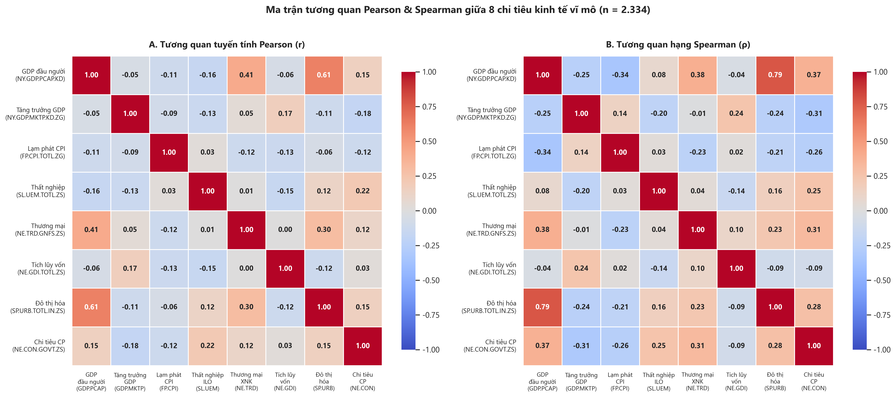
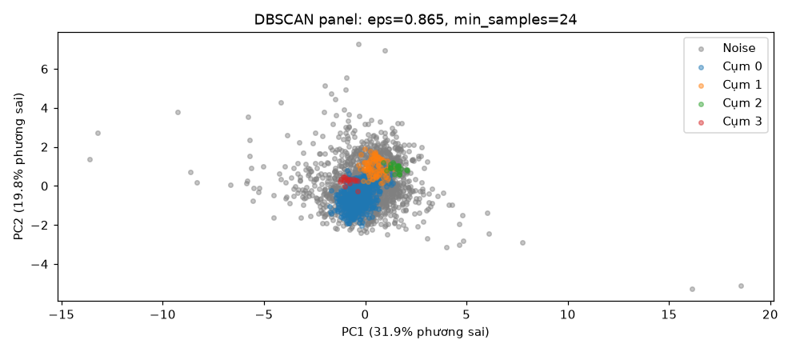
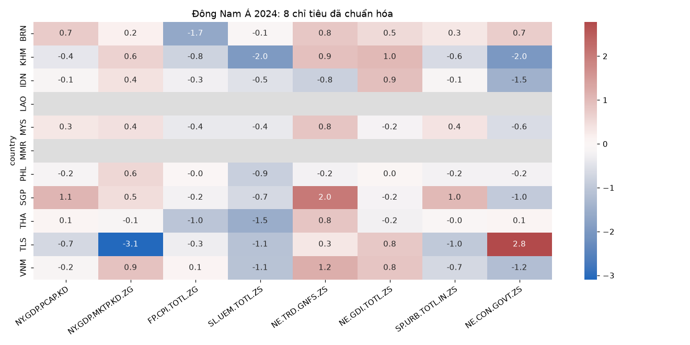

# Phân cụm quốc gia theo đặc điểm kinh tế vĩ mô bằng DBSCAN

## 1. Mục tiêu và thiết kế nghiên cứu

Nghiên cứu khảo sát các nhóm quốc gia có trạng thái kinh tế vĩ mô gần nhau và các quan sát không thuộc vùng đủ mật độ. Nguồn World Bank WDI gồm tám chỉ tiêu: GDP/người, tăng trưởng GDP, lạm phát, thất nghiệp, thương mại/GDP, tích lũy vốn/GDP, đô thị hóa và chi tiêu chính phủ/GDP. Giai đoạn khảo sát là 2010–2024, snapshot truy cập ngày 07/11/2026.

Mỗi quan sát là một quốc gia/vùng lãnh thổ–năm. Mô hình mô tả fit toàn panel tạo một hệ nhãn chung; cùng quốc gia có thể thuộc các cụm khác nhau ở các năm. Một thí nghiệm độc lập chia theo quốc gia được dùng để kiểm tra việc gán các quốc gia chưa thấy. Hai hệ nhãn được lưu và đánh giá riêng.

Không có nhãn chuẩn về “quốc gia thuộc cụm đúng”. Vì vậy nghiên cứu không báo accuracy, precision, recall hoặc một tỷ lệ dự đoán đúng. Silhouette không phải phần trăm chính xác; ARI = 1 khi đối chiếu thư viện chỉ chứng minh hai triển khai cho cùng phân hoạch.

## 2. Dữ liệu và tiền xử lý

Dữ liệu gốc có 3.990 hàng, gồm 217 nền kinh tế và 49 nhóm tổng hợp trong 15 năm. Sau khi loại nhóm tổng hợp còn 3.255 hàng và 26.040 ô chỉ tiêu; 3.001 ô thiếu (11,52%). Tích lũy vốn và chi tiêu chính phủ thiếu nhiều nhất, lần lượt 19,72% và 19,29%; đô thị hóa không thiếu.

Chỉ nội suy toàn khoảng thiếu bên trong dài tối đa hai năm, hoặc điền toàn khoảng biên dài một năm. Khoảng dài giữ thiếu; sau đó loại hàng chưa đủ tám biến. Có 32 ô được điền, trong đó 10 ô thuộc mẫu cuối; số hàng đủ biến tăng từ 2.310 lên 2.315. Mẫu cuối giữ 162 nền kinh tế, độ phủ theo năm 151–156. Việt Nam đủ 15 năm và không cần nội suy.

GDP/người, thất nghiệp, thương mại/GDP và chi tiêu chính phủ/GDP dùng log1p; lạm phát dùng signed-log1p để giữ giá trị âm. Ba biến còn lại giữ tuyến tính. RobustScaler trừ trung vị và chia IQR, không xóa các giá trị cực trị. Tham số toàn panel dùng cho mô tả; tham số trong thí nghiệm ngoài mẫu chỉ fit trên train.

Lựa chọn complete-case làm mất 55 nền kinh tế và có thể tạo thiên lệch độ phủ. Nội suy là ước tính, không phải số liệu quan sát trực tiếp. Nhật ký, quy tắc xử lý và checksum đi kèm dữ liệu bàn giao.

GDP/người và đô thị hóa có Pearson khoảng 0,614, Spearman khoảng 0,791. Giữ cả hai vì phản ánh khía cạnh khác nhau, đồng thời ghi nhận khoảng cách có thể tăng trọng số cho thông tin tương quan. Không suy luận nhân quả từ tương quan.

## 3. DBSCAN và lựa chọn tham số

Khoảng cách Euclidean được tính trên tám biến chuẩn hóa. Một điểm là core nếu lân cận bán kính eps có ít nhất min_samples điểm, tính cả chính nó; border gần core nhưng không mở rộng cụm; noise có nhãn -1.

Bản tự viết dùng NumPy và hàng đợi. Tám ca có đáp án biết trước, 11 ca đầu vào sai và 36 cấu hình blobs/moons được kiểm tra trực tiếp. Đối chiếu WDI toàn panel và train cho ARI = 1, khớp core và noise với scikit-learn. Những kiểm tra này xác nhận cách triển khai, không đánh giá đúng/sai về kinh tế.

Lưới mô tả có 90 cấu hình từ năm mức min_samples và 18 phân vị K-distance. Điều kiện cơ bản là 2–10 cụm, ít nhất ba quốc gia mỗi cụm và cụm lớn nhất không quá 90% non-noise. Ưu tiên cấu hình đạt độ phủ 65%, rồi Silhouette; nếu không đạt, chọn độ phủ cao nhất và ghi nhận kết quả thăm dò.

Không cấu hình nào đạt đồng thời điều kiện cơ bản và độ phủ 65%. Phương án eps = 0,865, min_samples = 24 được chọn trong miền đã thử; không khẳng định tối ưu toàn cục.

| Chỉ tiêu toàn panel | Kết quả |
| --- | ---: |
| Quan sát | 2.315 |
| Số cụm, không kể noise | 4 |
| Điểm thuộc cụm | 759 (32,79%) |
| Noise | 1.556 (67,21%) |
| Silhouette non-noise | 0,1889 |
| Davies–Bouldin non-noise | 0,9772 |
| Calinski–Harabasz non-noise | 106,81 |

Cụm 0 có 628 điểm từ 80 quốc gia, chiếm 82,74% non-noise. Các cụm 1, 2, 3 lần lượt có 89, 24 và 18 điểm. Silhouette gần 0 và tỷ lệ noise cao cho thấy phân chia còn hạn chế về độ tách và mức bao quát.

## 4. Huấn luyện và kiểm định ngoài mẫu

Các quốc gia được chia seed 42 theo tỷ lệ mục tiêu 60%/20%/20%. Tất cả các năm của một quốc gia thuộc cùng tập; RobustScaler chỉ fit trên train. Phép chia gồm 97 quốc gia train, 32 validation và 33 test. Không dùng phép chia ngẫu nhiên từng dòng vì có nguy cơ đưa các năm gần nhau của một quốc gia sang cả train và test.

DBSCAN không có predict mặc định. Quy tắc gán điểm mới là lấy nhãn core train gần nhất trong bán kính eps; nếu không có, gán -1. Điểm mới không tạo hoặc mở rộng cụm. Đây là phần mở rộng gán nhãn, không phải chạy lại DBSCAN trên test.

Lưới eps lấy từ K-distance train. Validation chọn cấu hình sau khi áp dụng điều kiện cụm trên train; test chỉ được đánh giá sau khi cấu hình được cố định. Trong 90 lần thử, một cấu hình đủ điều kiện có chỉ số validation hợp lệ: eps = 0,902, min_samples = 16. Mục tiêu độ phủ validation không đạt; kết quả không được đổi lại bằng cách chọn seed hay tham số từ test.

| Tập | Quốc gia | Điểm | Được gán | Độ phủ | Noise/từ chối | Số nhãn cụm xuất hiện | Silhouette | DBI | CH |
| --- | ---: | ---: | ---: | ---: | ---: | ---: | ---: | ---: | ---: |
| Train | 97 | 1.397 | 505 | 36,15% | 63,85% | 3 | 0,0986 | 1,1796 | 77,01 |
| Validation | 32 | 464 | 117 | 25,22% | 74,78% | 2 | 0,1839 | 1,0318 | 13,36 |
| Test | 33 | 454 | 90 | **19,82%** | **80,18%** | 1 | **N/A** | **N/A** | **N/A** |

Test chỉ có một nhãn trong các điểm được gán, nên không đủ điều kiện tính ba chỉ số nội bộ. Giá trị N/A không được thay bằng 0; độ phủ 19,82% không phải độ chính xác. Thí nghiệm chưa cung cấp bằng chứng về khả năng phân tách nhiều nhóm quốc gia chưa thấy.

Dữ liệu thiếu được xử lý trong chính chuỗi từng quốc gia trên toàn giai đoạn. Do đó phép thử đánh giá chuyển sang quốc gia chưa thấy trong phân tích hồi cứu, không đánh giá dự báo thời gian tương lai. Việc lọc mẫu/thiết kế đặc trưng vẫn dựa trên phạm vi nghiên cứu đã xác lập; đây không phải một tập dữ liệu mới thu thập độc lập.

## 5. Độ ổn định và thuật toán đối chứng

Thay eps ±10% và min_samples ±20% làm noise biến thiên 49,42%–91,19%, số cụm từ hai tới năm. Đảo thứ tự giữ ARI = 1. Với nhiễu nhỏ, ARI toàn mẫu trung bình 0,9269 nhưng ARI trên giao non-noise thấp nhất 0,2514; không thể kết luận ổn định chỉ nhờ nhiều điểm vẫn là noise. Khi lấy 80% quốc gia, ARI toàn mẫu trung bình 0,8319.

K-Means chọn k = 5 theo Silhouette, Agglomerative/Ward chọn k = 2, GMM chọn 10 thành phần covariance full theo BIC trong mô hình hội tụ. GMM chạm biên miền thử k=2..10 nên chưa xác lập tối ưu toàn cục.

Để so cùng mẫu, giữ nhãn đã fit toàn panel và đánh giá cả bốn thuật toán trên 759 non-noise của DBSCAN:

| Thuật toán | Silhouette | DBI | CH |
| --- | ---: | ---: | ---: |
| DBSCAN | 0,1889 | 0,9772 | 106,81 |
| K-Means | 0,2589 | 1,2590 | 201,72 |
| Agglomerative | 0,2679 | 1,3170 | 180,19 |
| GMM | 0,0601 | 2,0028 | 106,60 |

Agglomerative thuận lợi hơn theo Silhouette, DBSCAN theo DBI và K-Means theo CH; không có phương pháp trội ở mọi chỉ số. Tập con do DBSCAN lựa chọn nên kết quả có điều kiện. Các đối chứng có độ phủ 100% theo thiết kế, không phải độ chính xác 100%.

## 6. Hồ sơ cụm và Việt Nam

Cụm 0 có GDP/người trung vị khoảng 15.140 USD, đô thị hóa 71,57%; cụm 1 khoảng 1.291 USD và 41,88%. Cụm 2 có tăng trưởng trung vị 7,31%, tích lũy vốn/GDP 33,23%; cụm 3 có thất nghiệp 24,71%, tăng trưởng 1,37%. Các cụm nhỏ chỉ có 3–4 quốc gia, cần dè dặt khi khái quát đặc điểm.

Trong noise, tích lũy vốn là biến lệch IQR lớn nhất ở 464 điểm, tăng trưởng ở 363 và lạm phát ở 284 điểm. Đây là dấu hiệu mô tả khác biệt so với non-noise, không phải phân tích nhân quả của việc trở thành noise.

Việt Nam là noise ở cả 15 năm, trong khi GDP/người tăng từ 2.027,58 USD năm 2010 lên 4.012,51 USD năm 2024. Năm 2024 tăng trưởng 7,04%, lạm phát 3,62%, thương mại/GDP 173,89% và đô thị hóa 38,49%. Không thể suy từ nhãn noise sang khủng hoảng hoặc điều hành kém.

Cambodia là nước gần Việt Nam nhất theo tám biến chuẩn hóa năm 2024, khoảng cách 1,5474; khoảng cách lớn hơn eps không tạo quan hệ láng giềng mật độ. GDP/người Việt Nam gần Philippines và Indonesia nhưng thương mại/GDP cao hơn, đô thị hóa thấp hơn. So sánh này mô tả vị trí đa chiều, không xác định nguyên nhân của nhãn.

Đông Nam Á có chín nước đủ biến năm 2024; Laos và Myanmar thiếu hàng trong mẫu năm đó. Trên bản đồ toàn mẫu năm 2024, 139/151 nền kinh tế có hình học ở tỷ lệ 1:110m; 12 nền kinh tế thiếu hình học được ghi riêng.

## 7. Kết luận

Thuật toán và luồng dữ liệu đã được kiểm tra, nhưng mô hình hiện chưa đạt chất lượng để khẳng định phân chia quốc gia bao quát hoặc tổng quát hóa tốt. Kết quả thích hợp trình bày như một nghiên cứu thăm dò về ưu điểm và giới hạn của DBSCAN trên tám biến vĩ mô, đồng thời minh họa vì sao kiểm thử code, độ phủ, điểm nội bộ và kiểm định ngoài mẫu phải được đọc riêng.

Một thí nghiệm tiếp theo có thể xem xét mật độ biến thiên, đặc trưng kinh tế khác hoặc thiết kế theo năm; các lựa chọn đó cần được đánh giá bằng một kế hoạch và tập kiểm định mới, không dùng kết quả test hiện tại để điều chỉnh rồi báo lại như kiểm định độc lập.

## Tài liệu tham khảo

- [World Bank — World Development Indicators](https://datacatalog.worldbank.org/search/dataset/0037712/world-development-indicators): nguồn dữ liệu.
- [scikit-learn — DBSCAN](https://scikit-learn.org/stable/modules/clustering.html#dbscan): nguyên lý, tham số và giới hạn mật độ.
- [scikit-learn — Silhouette Score](https://scikit-learn.org/stable/modules/generated/sklearn.metrics.silhouette_score.html): điều kiện và cách đọc chỉ số.
- [scikit-learn — Adjusted Rand Index](https://scikit-learn.org/stable/modules/generated/sklearn.metrics.adjusted_rand_score.html): so sánh phân hoạch.
- [Natural Earth](../du_lieu/ban_do/README.md): nguồn ranh giới bản đồ.
